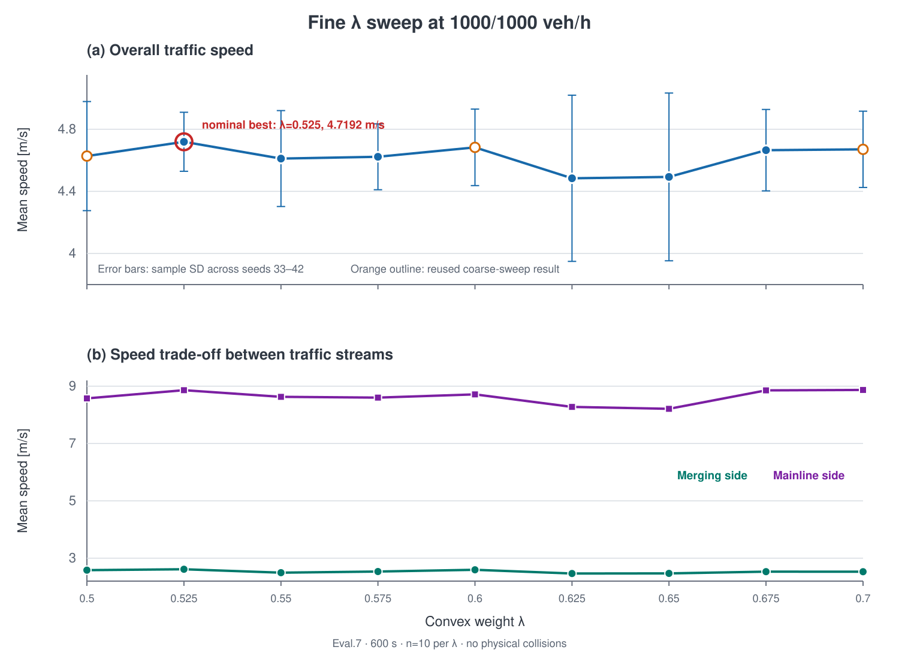
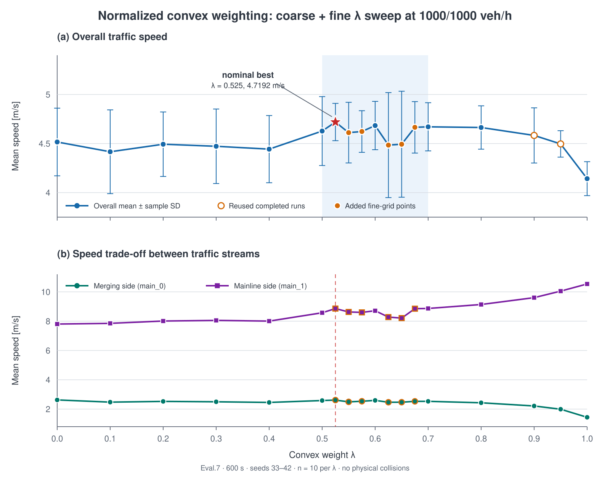

# 正規化凸結合式 lambda 0.50–0.70細密600秒スイープ

- 台帳ID: `2026-11-19-normalized-convex-lambda-fine-sweep-600s-development`
- 状態: `completed`
- 位置づけ: `development screening`
- 開始日時: 2026-11-19 17:34:56 JST
- 終了日時: 2026-11-20 17:29:52 JST
- 新規実験ディレクトリ:
  - `results/runs/normalized-convex-lambda0525-eval7-r1000-a1000-seeds33-42-600s-20261119/`
  - `results/runs/normalized-convex-lambda0550-eval7-r1000-a1000-seeds33-42-600s-20261119/`
  - `results/runs/normalized-convex-lambda0575-eval7-r1000-a1000-seeds33-42-600s-20261119/`
  - `results/runs/normalized-convex-lambda0625-eval7-r1000-a1000-seeds33-42-600s-20261119/`
  - `results/runs/normalized-convex-lambda0650-eval7-r1000-a1000-seeds33-42-600s-20261119/`
  - `results/runs/normalized-convex-lambda0675-eval7-r1000-a1000-seeds33-42-600s-20261119/`
- 既存再利用:
  - `lambda=0.50`: `results/runs/normalized-convex-lambda050-eval7-r1000-a1000-seeds33-42-600s-20261117/`
  - `lambda=0.60`: `results/runs/normalized-convex-lambda060-eval7-r1000-a1000-seeds33-42-600s-20261117/`
  - `lambda=0.70`: `results/runs/normalized-convex-lambda070-eval7-r1000-a1000-seeds33-42-600s-20261117/`

## 目的

1000/1000 veh/h・600秒の粗いlambdaスイープで全車平均速度が高かった`0.50–0.70`を
`0.025`刻みで細密化し、平均速度と合流側・本線側のトレードオフが最も良い領域を絞る。
本実験はlambdaを選ぶdevelopmentであり、最終的な一般性能の確認ではない。

## 仮説と比較対象

- 仮説: 粗いスイープの平均1位`lambda=0.60`付近に高性能域があるが、真の最良点は
  `0.525–0.675`の中間点にある可能性がある。
- 基準実験:
  [`2026-11-17-normalized-convex-lambda-wide-sweep-600s-development`](2026-11-17-normalized-convex-lambda-wide-sweep-600s-development.md)
- 基準から変更するもの: lambdaだけを`0.525, 0.550, 0.575, 0.625, 0.650, 0.675`へ変更する。
- 固定するもの: 実行ソース、評価式、固定入力、seed、交通量、Bus比率、時間、ログ条件、
  Python/SUMO版を粗いスイープと一致させる。
- 採否基準: 完全性・物理衝突を通過した候補について、全車平均速度を主指標とし、
  合流側・本線側速度、停止、急減速、流出、未挿入、残留、Accept率、最悪seed、標準偏差、
  seed対応差、bootstrap区間、Pareto関係を併記する。
- 結果を見た後に変更しないもの: seed、固定入力、600秒評価窓、評価式、候補点、再実行規則。

## 条件

| 項目 | 値 |
| --- | --- |
| 方式 | 正規化減速伝播提案 `M=(1-lambda)Z_time+lambda Z_follow` |
| ケース | Eval.7 |
| 新規lambda | `0.525, 0.550, 0.575, 0.625, 0.650, 0.675` |
| 既存再利用lambda | `0.50, 0.60, 0.70` |
| seed | `33, 34, 35, 36, 37, 38, 39, 40, 41, 42` |
| シミュレーション時間 | 600 s |
| 入力 | `fixed_inputs/thesis/eval7-flow-sweep/requesting-1000-accepting-1000/seed-{seed}.jsonl` |
| 交通量・Bus比率 | 合流側1000 / 本線側1000 veh/h、Bus 25% fixed |
| 主要パラメータ | `T_pred=10 s`, `N_max=40` |
| 診断ログ | screeningのためdiagnostic traceなし、checkpointなし。manifest、runner/stdout/stderr、評価指標、物理衝突、prediction auditは保存 |
| Python / SUMO | 3.15.1 / 1.28.0 |
| OS・実行機 | Ubuntu `sgnlab` |
| 並列数 | lambda昇順・seed昇順の共有queue、機械全体最大15 SUMO、1件終了ごとに次の1件を補充 |

最初は`lambda=0.525`の10件と`lambda=0.550`のseed 33–37を投入する。以後は15件の
同時完了を待たず、空いたslotへqueue先頭の1件を補充する。失敗時は新規投入を停止し、
自動再実行やseed差し替えは行わない。

## 再現用Git情報

| 項目 | 値 |
| --- | --- |
| 記録branch | `codex/normalized-convex-lambda-fine-sweep-600s-development` |
| 実行ソースcommit | `e0f36fc461a37e179bf831121ef01b982c5121db` |
| 実行開始時dirty | `false`を必須とする |
| scheduler | `scripts/run_lambda_shared_queue.py`、commit `efe027881`、SHA-256 `50de94809aff35bd9920b659c2acbe6fe751a73ac7ce8ccc2f3efc6ea7c1f9f9`。先行バッチなしのfresh queueとして起動 |
| 結果commit | lambdaごとの専用commitを後述 |
| 記録commit | 本記録のcommit |

各lambdaは実行ソースcommitから作成した独立clean worktreeを使い、各結果ディレクトリを
そのworktreeの`results/runs/`へ保存する。実行条件は次の共有queue投入と等価である。

```text
scripts/run_thesis_batch.py
  --cases eval7
  --seeds 33 34 35 36 37 38 39 40 41 42
  --duration 600
  --eval7-flows 1000 1000
  --fixed-input-override fixed_inputs/thesis/eval7-flow-sweep/requesting-1000-accepting-1000/seed-{seed}.jsonl
  --bus-allocation fixed
  --deceleration-active
  --deceleration-convex-lambda <lambda>
  --no-diagnostic-traces
  --checkpoint-interval 0
  --run-name normalized-convex-lambda<tag>-eval7-r1000-a1000-seeds33-42-600s-20261119
```

## 監視

- 対象unit: `mcs-normalized-convex-lambda-fine-sweep-600s-20261119.service`
- invocation ID: `d7920f91a00b460ebfe4b932af093582`
- 60%未満は30分、60%以上は15分ごとにUbuntuの実状態を確認する。
- 各確認で完了/60、失敗数、最遅simulation time、実SUMO数、queueの次候補、停滞、
  traceback、ディスクを報告する。

2026-11-19 17:34:56 JSTに正式起動した。8秒後の読み返しでunitは`active/running`、
実SUMOは15 processだった。最初の15件はqueue index 0–14の昇順で、`lambda=0.525`の
seed 33–42と`lambda=0.550`のseed 33–37だった。6候補のexperiment manifestと開始済み
15 runのmanifestから、実行ソース`e0f36fc...`、Git clean、lambda値、Python 3.15.1、
SUMO 1.28.0、固定15 slotを確認した。開始時の失敗は0件である。

## 完了・完全性確認

- [x] 新規6バッチ・60 runが正常完了
- [x] 全runが`exit_code: 0`、`source_unchanged: true`
- [x] 実行開始時Git clean、source SHA、固定入力SHAを確認
- [x] lambda以外の条件が全候補で一致
- [x] Python/SUMO版、manifest、runner/stdout/stderr、評価指標を確認
- [x] 物理衝突と致命的ログを確認
- [x] lambda別・seed別集計と既存`0.50/0.60/0.70`を統合
- [x] 正常結果だけをlambdaごとの専用commitで保存・push

## 結果

### 正常終了と完全性

2026-11-20 17:29:52 JSTに新規60 runが完了した。全runで`exit_code: 0`、
`source_unchanged: true`、実行開始時Git clean、実行ソース`e0f36fc...`、
同一seedの固定入力SHA一致、Python 3.15.1、SUMO 1.28.0を確認した。
manifest、runner/stdout/stderr、evaluation metrics、prediction audit、FCDの599.9秒までの
完了、物理衝突を監査し、致命的ログ0、物理衝突0だった。

共有queueの`simulation_started`と`slot_filled`はともにqueue index 0–59の
昇順・重複なしで、完了は60/60、実SUMO数の最大は15、slot超過とabortはなかった。

### lambda別の主要指標

| lambda | 全車速度 [m/s] | 合流側 [m/s] | 本線側 [m/s] | 停止 [s] | 急減速 [s] | 流出 | 未挿入 | 残留 | Accept率 | 最悪seed |
| ---: | ---: | ---: | ---: | ---: | ---: | ---: | ---: | ---: | ---: | ---: |
| 0.500※ | 4.6273 ± 0.3512 | 2.5834 | 8.5729 | 3642.46 | 7.30 | 230.2 | 59.4 | 42.4 | 43.01% | 3.6557 |
| **0.525** | **4.7192 ± 0.1899** | **2.6146** | 8.8588 | **3282.80** | 6.41 | 232.1 | **58.2** | 41.7 | 42.85% | **4.3724** |
| 0.550 | 4.6113 ± 0.3088 | 2.4936 | 8.6278 | 3873.99 | 5.69 | 231.4 | 62.5 | **38.1** | **43.56%** | 3.9269 |
| 0.575 | 4.6226 ± 0.2122 | 2.5335 | 8.6005 | 3590.31 | 5.44 | 231.3 | 61.0 | 39.7 | 40.60% | 4.3258 |
| 0.600※ | 4.6835 ± 0.2465 | 2.5949 | 8.7130 | 3438.13 | 5.49 | **232.3** | 59.0 | 40.7 | 38.44% | 4.2077 |
| 0.625 | 4.4842 ± 0.5349 | 2.4661 | 8.2768 | 3963.28 | 5.44 | 224.1 | 64.0 | 43.9 | 36.77% | 3.1265 |
| 0.650 | 4.4930 ± 0.5400 | 2.4694 | 8.2103 | 4072.93 | 5.07 | 226.9 | 63.7 | 41.4 | 34.58% | 3.3126 |
| 0.675 | 4.6653 ± 0.2621 | 2.5303 | 8.8525 | 3818.64 | **4.29** | 228.4 | 61.1 | 42.5 | 35.16% | 4.1699 |
| 0.700※ | 4.6707 ± 0.2456 | 2.5285 | **8.8670** | 3968.26 | 4.98 | 227.8 | 62.0 | 42.2 | 34.20% | 4.1699 |

※は同一条件の粗いスイープの完了結果を再利用した。流出はFCDへ1回以上現れ、
最終時刻599.9秒に残っていない車両数、未挿入は予定332台とFCD挿入数の差である。



### 広域・細密スイープの統合曲線



青点は広域グリッド、橙色の塗りつぶし点は今回追加した細密グリッド、
橙色の白抜き点は別バッチから再利用した`lambda=0.90/0.95`を示す。
淡青色の帯は細密探索した`0.50–0.70`の範囲である。

### seed対応差と不確実性

全車平均速度の名目1位は`lambda=0.525`だった。seed対応percentile bootstrapを
200,000回行い、固定乱数seedは`20261120`とした。

| 比較 | 全車速度差 [m/s] | 0.525より高いseed | 95% bootstrap区間 [m/s] |
| --- | ---: | ---: | ---: |
| 0.500 − 0.525 | -0.0919 | 4/10 | [-0.3918, +0.1064] |
| 0.550 − 0.525 | -0.1080 | 4/10 | [-0.2709, +0.0326] |
| 0.575 − 0.525 | -0.0966 | 3/10 | [-0.2794, +0.0867] |
| 0.600 − 0.525 | -0.0358 | 5/10 | [-0.1380, +0.0590] |
| 0.625 − 0.525 | -0.2350 | 2/10 | [-0.5384, -0.0332] |
| 0.650 − 0.525 | -0.2262 | 3/10 | [-0.5045, -0.0195] |
| 0.675 − 0.525 | -0.0539 | 2/10 | [-0.1844, +0.0833] |
| 0.700 − 0.525 | -0.0485 | 4/10 | [-0.1656, +0.0626] |

`0.525`は全車速度に加え、合流側速度、停止時間、未挿入、最悪seed、
seed間標準偏差も良好だった。一方、粗いグリッドの1位`0.60`との差は
`+0.0358 m/s`で、`0.525 − 0.60`の95%区間は`[-0.0590, +0.1380] m/s`と
0をまたぎ、優越性は確立しなかった。`0.625/0.650`はseed 38の落ち込みを
含むtail riskが大きく、`0.525`との差の区間も0未満だった。

全車・合流側・本線側速度と流出を最大化、停止・急減速・未挿入・残留を
最小化する集計値のPareto監査では、`0.500`と`0.625`が支配された。
他候補には少なくとも1指標のトレードオフが残った。

### 結果保存

prediction JSONLとSUMO FCD XMLを`gzip -n -6`で可逆圧縮し、復元SHA-256、サイズ、
行数を120 artifactで照合した。圧縮対象は18,143,276,350 bytesから5,659,428,761 bytesに
なった。100 MB以上の圧縮ファイル1件は80,000,000 byte単位へ分割し、連結SHAを照合した。

| lambda | 結果branch | 結果commit |
| ---: | --- | --- |
| 0.525 | `codex/normalized-convex-lambda0525-600s-20261119` | `6e38c22611d1afd585bc1e79ed43333c641b5112` |
| 0.550 | `codex/normalized-convex-lambda0550-600s-20261119` | `196fcd75e0a8793a4b118a9b58a013d366df3038` |
| 0.575 | `codex/normalized-convex-lambda0575-600s-20261119` | `e089a8c7d084edeaa47ab95dad7fa2052ee9c222` |
| 0.625 | `codex/normalized-convex-lambda0625-600s-20261119` | `c0ca3223a2884fda5158715bb5b0889dad87867d` |
| 0.650 | `codex/normalized-convex-lambda0650-600s-20261119` | `b8ad4f56593c4b4b8de911cfdee01314e63d2ef4` |
| 0.675 | `codex/normalized-convex-lambda0675-600s-20261119` | `bdaecf1d96fbb5ad9f5bc8d559ed0b9ed599566d` |

各実験ディレクトリの`post-run-audit.json`、`compression-audit.json`、
`storage-split-audit.json`はすべて`ok/all_verified: true`である。`lambda=0.525`の結果に
`lambda-fine-sweep-summary.json`としてseed別・候補別集計を保存した。

## 結論

- 確認できたこと: この10 seedでの名目最良は`lambda=0.525`で、平均速度、
  tail risk、合流側処理のバランスが良好だった。新規60 runの物理衝突は0だった。
- 確認できなかったこと: `0.525`が`0.60`より一般に優れることと、
  交通量比や未使用seedに対する最適lambdaは確認していない。
- 採否・次の判断: `0.525`を細密探索の名目候補とし、`0.60`を強い対照として残す。
  次は両方を診断trace・checkpoint付きで確認し、未使用seedで最終選択する。
- 既存の研究判断から変わったこと: 粗いスイープの名目1位`0.60`に対し、
  細密候補`0.525`が点推定で上回った。ただし差の不確実性は大きく、`0.60`を棄却しない。

## 限界・異常

seed 33–42は粗いlambda探索に使用済みであり、今回も同じseedを使って細密候補を選ぶ。
したがって本実験は独立holdoutではなく、lambda固定後に未使用seedで最終評価する必要がある。
名目1位を同じseedで選んだ後のbootstrap区間は候補選択に対する多重性を補正しない。
また、隣接lambdaの結果は単調ではなく、`0.625/0.650`で特定seedの大きな落ち込みがあるため、
現グリッドの曲線補間で真の最適値を推定しない。

## 次の作業

1. `lambda=0.525/0.60`を診断trace・checkpoint付きで確認する。
2. 結果を見ていないseedを事前固定し、最終候補を選ぶ。
3. 合流側交通量別のlambdaは、本1000/1000結果を流用せず別のdevelopmentとして設計する。
